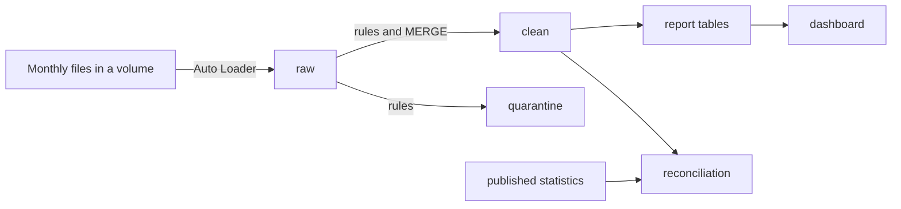
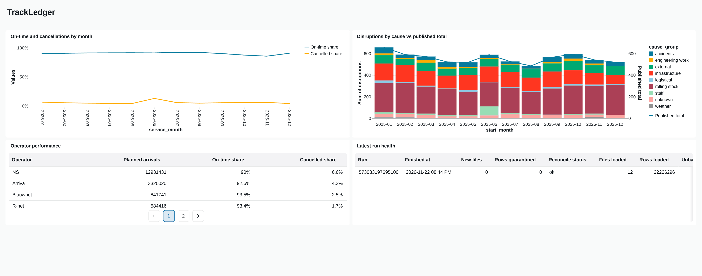

# TrackLedger

    

Automated monthly reporting on Dutch rail operations, built with PySpark on Databricks and validated against the statistics it replaces.

## Context

A recurring report that is put together by hand costs time every month. Automating it only helps if its users can trust the new numbers as much as the old ones. TrackLedger works through that problem on open data. It builds a monthly report on train punctuality and disruptions in the Netherlands from the archives of Rijden de Treinen, and it checks its own output in two ways. Every input record has to be accounted for, and the disruption figures have to match the statistics that Rijden de Treinen publishes from the same archive.

The 2025 data holds 22,226,296 train stops in twelve monthly files and 6,676 disruptions. On this data the pipeline reproduces 35 of 36 published figures, accounts for every record, and adds a new month without creating duplicates.

## Design



One Databricks job, `trackledger-monthly`, runs four notebook tasks in order and is scheduled for the second day of each month. The notebooks in `tasks/` are thin. All logic lives in the `trackledger` package as plain DataFrame functions, and every name, schema, rule, KPI definition and tolerance comes from `contract.py`.

| Task | What it does |
|---|---|
| `ingest_landing` | Loads new services files into `raw_services` and refreshes the disruptions and stations snapshots. |
| `build_clean` | Applies the quality rules, sets bad rows aside with the rule name, checks the row balance and merges into `clean_services`. |
| `build_report` | Rebuilds the three report tables behind the dashboard. |
| `check_published` | Compares the disruption figures with the published ones, writes `reconciliation` and fails on a breach. |

Auto Loader keeps a checkpoint of the files it has already read, so a new month is picked up without any code change and no file is loaded twice. The clean table is a Delta merge keyed on train service and station rather than an append, so a rerun cannot create duplicates. Keeping the logic out of the notebooks means the same code also runs locally on PySpark, so it was tested on the full dataset before it ran on Databricks.

All tables live in Unity Catalog under `workspace.trackledger`, with table and column comments. `run_log` keeps one row per task run, and the last dashboard tile reads from it. [docs/architecture.md](docs/architecture.md) lists every table, rule and KPI definition and has a short guide for the report owner.

## Validation

Before an automated report can replace a manual one, it has to reproduce the existing figures, account for every record, and give the same result when it runs again.

### Reproducing the published figures

Rijden de Treinen publishes monthly and yearly disruption statistics. I fixed the comparison before the first run. Counts must match exactly, and average durations may differ by at most one minute because the site rounds to whole minutes. Which cause field to use, and which month a disruption belongs to, followed from the site's documentation rather than from trying options until the numbers fit.

| Published figure | Figures | Tolerance | Result |
|---|---|---|---|
| Disruptions per month | 12 | exact | 12 match |
| Average duration per month | 12 | 1 minute | 12 within |
| Disruptions and average duration in 2025 | 2 | as above | 2 match |
| Ten largest causes in 2025 | 10 | exact | 9 match, 1 explained |

The one exception is the number of disruptions caused by a technical investigation, 302 against 290. Every monthly total matches, and the site's own monthly pages also add up to 290. The difference therefore lies in the cause label of 12 disruptions, not in their count. The open data is a yearly export while the statistics come from the live archive, so the most likely explanation is a cause revised after the export. The job records this case as explained and fails on any other difference.

### Accounting for every record

For each monthly file, the lines in the file, the rows loaded and the rows kept or set aside must be equal. All twelve files balance. No row broke a quality rule and no duplicate was found. 17,625 stops refer to a station code that is missing from the station list, and these are kept and counted rather than dropped.

### Repeated runs

| Run | New files | Rows inserted | Rows updated |
|---|---|---|---|
| January to November | 11 | 20,386,370 | 0 |
| December | 1 | 1,839,926 | 0 |
| Rerun without new data | 0 | 0 | 0 |

The December file was loaded as the only new file, and a second run changed nothing. A local run of the same code on the same data produced identical report tables, which `scripts/check_parity.py` confirms table by table.

## Findings



In 2025, 90.3% of measured train arrivals were less than three minutes late and 5.7% of planned arrivals were cancelled. June stands out, with 12.8% of arrivals cancelled against 3.9% to 6.4% in the other months, and a peak in staff-related disruptions in the same month. Punctuality was lowest in November at 85.6%.

Building the report also exposed a gap in the source data. DB reports a delay on 1 of its 345,118 arrivals, which points to missing delay data rather than perfect punctuality. Counting those arrivals as on time would inflate the figures, so an operator needs at least 1% of arrivals with some delay before it receives an on-time share. Cancellations still count for every operator.

## Limitations

The published statistics come from the same archive, so agreement shows that the pipeline processes the data correctly but says nothing about whether the archive is complete. As a rule, NS only announces a disruption when several trains are affected. The punctuality figures follow my own definitions and cannot be compared one to one with official NS or ProRail figures. Auto Loader only runs on Databricks, so the local run tests a batch fallback that keeps track of processed files itself.

## Reproducing the results

The code needs Python 3.11 and Java 17. The data comes from [Rijden de Treinen](https://www.rijdendetreinen.nl/en/open-data) and goes in `data/landing/{services,disruptions,stations}/`. On Databricks, create the schema `workspace.trackledger` with a volume `landing`, upload the data, add this repository as a Git folder and create the job from `orchestration/job.yml`. The commands below install, test and run it locally.

```bash
pip install -r requirements.txt
pytest                                    # unit tests on small fixtures
python -m scripts.run_local data/landing  # full local run (Linux or macOS)
python -m scripts.check_parity summary.json run_log.csv
```

```
trackledger/   contract, readers, quality rules, report tables, reconciliation
tasks/         the four Databricks notebooks
scripts/       local reference run and parity check
dashboard/     one query per dashboard tile and the exported dashboard
results/       local and Databricks run summaries, dashboard screenshot
```

The data is published by Rijden de Treinen under CC BY 4.0. The code is MIT licensed.
