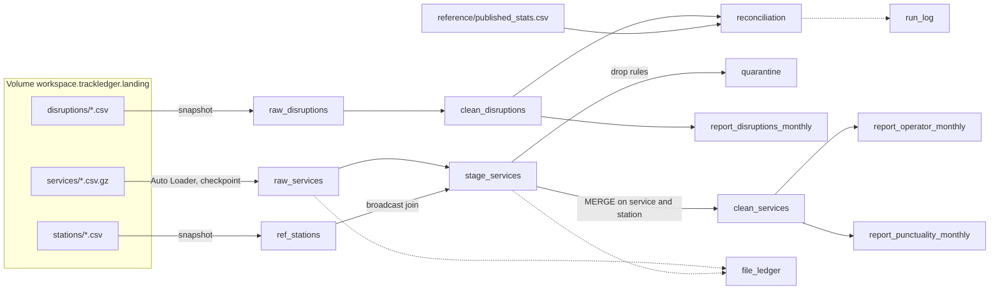

# Architecture

TrackLedger turns the open Rijden de Treinen archives into a monthly rail report on Databricks. Every row is accounted for between layers, and the disruption figures are checked against the statistics that Rijden de Treinen publishes.

## Flow

One job, `trackledger-monthly`, runs four tasks in order: `ingest_landing`, `build_clean`, `build_report` and `check_published`. Each task is a thin notebook in `tasks/` that calls pure DataFrame functions in the `trackledger` package. All names, schemas, rules, KPI definitions and tolerances live in `trackledger/contract.py`.

## Layers

| Table | Written by | How |
|---|---|---|
| `raw_services` | ingest | Auto Loader appends only new files. Fallback: batch read of files not yet in `file_ledger`. |
| `raw_disruptions`, `ref_stations` | ingest | Full snapshot, overwritten each run. |
| `stage_services` | clean | The current batch with rule results and duplicate rank, rebuilt each run. |
| `clean_services` | clean | Delta MERGE on `(service_rdt_id, station_code)`. A rerun inserts and updates nothing. |
| `clean_disruptions` | clean | Rebuilt from the snapshot. |
| `quarantine` | clean | Dropped rows with the rule name and the original row as JSON. |
| `report_*` | report | Rebuilt from the clean layer. |
| `reconciliation` | reconcile | Ours against published, with tolerance and status. |
| `file_ledger`, `run_log` | all | Row balance per file and one row per task run. |

## Checks

**Row balance.** For every services file, the plain-text line count must equal the raw rows, and raw rows must equal clean plus quarantined plus duplicates. A file that does not balance fails the task.

**Quality rules.** Drop rules send rows to `quarantine`: a value that does not fit the schema, a missing service or station, a missing operating day, a delay outside 0 to 1440 minutes. Warn rules only count: a station code that is not in the stations list (mostly metro and foreign stops missing from the 2023 list), a disruption without an end time, a stated duration that differs from end minus start. The clean task fails if more than 1% of a batch is quarantined.

**Time zones.** The session time zone is `Europe/Amsterdam`. Services timestamps carry their own offset. Disruption times are local wall-clock times, so a disruption belongs to the month of its local start time. Two real disruptions cross a daylight-saving change and their stated durations only match end minus start when the times are read as Dutch local time. A test proves this.

**Reconciliation.** The reference file holds 36 published figures: the count and average duration for each month and for the year, and the ten largest causes of 2025. Tolerances were fixed before the first run: counts must match exactly, the average duration within 1 minute because the site rounds to minutes. A figure outside its tolerance fails the job unless the contract lists it as a known gap with a documented reason. Filters are never changed to close a gap.

Rijden de Treinen's documentation says the statistics use the statistical cause, which keeps the descriptive cause when NS later changes it to a generic one such as an earlier disruption. TrackLedger therefore counts causes on `statistical_cause_en`.

## KPI definitions

These are internal definitions, not NS or ProRail KPIs.

- **Planned arrival:** a stop of a train service with a planned arrival time. Replacement buses (service types containing "bus") are left out.
- **On-time share:** arrivals less than 3 minutes late, divided by arrivals that were not cancelled and have a delay. Delays are whole minutes as published.
- **Cancelled share:** cancelled arrivals divided by planned arrivals.
- **Delay data:** an operator counts as having delay data in a month when at least 1% of its measured arrivals show a delay above zero. Some operators, such as DB, report zero delay on almost every stop, which would read as 100% on time. Their on-time share stays empty and they are left out of the network on-time share. Their cancellations still count.
- **Month:** the operating day of the service for punctuality, the local start time for disruptions.
- **Disruption count and average duration:** rows in the disruptions archive per local start month; the average uses the published `duration_minutes` and leaves out disruptions without an end time.

## Guide for the report owner

The dashboard answers three questions.

1. **How did the network perform?** Tile 1 shows the monthly on-time share and cancelled share. Tile 3 splits the same figures by operator.
2. **What caused the disruptions?** Tile 2 shows disruptions per month by cause group, next to the total that Rijden de Treinen publishes for that month.
3. **Can I trust these numbers?** Tile 4 shows the last run, how many files were loaded, whether every file balanced, how many rows were quarantined and how many published figures matched.

A new month arrives as one file in `landing/services`. The monthly job picks it up and leaves files it has already loaded alone. If a quality check fails, the job stops before the clean and report tables change. If a published figure does not match, the job run is marked failed. In both cases `quarantine` or `reconciliation` names the rows or figures to look at.

Data: Rijden de Treinen, CC BY 4.0.
